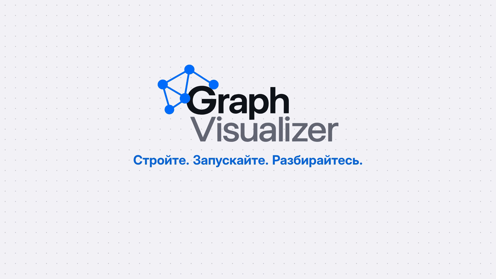
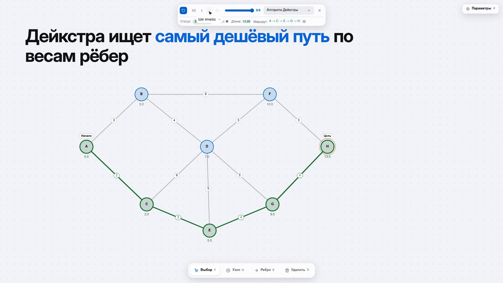

<div align="center">

<picture>
  <source media="(prefers-color-scheme: dark)" srcset="material/logo-dark.svg">
  <source media="(prefers-color-scheme: light)" srcset="material/logo.svg">
  
</picture>

**Стройте. Запускайте. Разбирайтесь.**

Интерактивный визуализатор алгоритмов на графах с пошаговой анимацией в реальном времени через Server-Sent Events.

[](https://openjdk.org/)
[](https://spring.io/projects/spring-boot)
[](https://nextjs.org/)
[](https://react.dev/)
[](https://www.typescriptlang.org/)
[](https://tailwindcss.com/)
[](https://docs.docker.com/compose/)
[](https://nginx.org/)
[](https://redis.io/)
[](https://prometheus.io/)
[](https://grafana.com/)
[](https://opentelemetry.io/)
[](https://playwright.dev/)
[](LICENSE)
[](#тестирование)
[](#тестирование)
[](#e2e-тесты-playwright)
[](#участие-в-разработке)


</div>

<p align="center">
  <a href="demo/demo-60fps.mp4">
    
  </a>
  <br>
  <sub>▶ Нажмите, чтобы посмотреть демо (<a href="demo/demo-60fps.mp4">60 fps</a> · <a href="demo/demo-30fps.mp4">30 fps</a> · <a href="demo/promo.mp4">промо</a>)</sub>
</p>

<p align="center">
  
  <br>
  <sub>Алгоритм Дейкстры: пошаговый проигрыватель, расстояния под узлами и найденный маршрут A → C → E → G → H (длина 13)</sub>
</p>

---

## Содержание

- [Возможности](#возможности)
- [Технологический стек](#технологический-стек)
- [Архитектура](#архитектура)
- [Быстрый старт](#быстрый-старт)
- [Использование](#использование)
- [API](#api)
- [Наблюдаемость](#наблюдаемость)
- [Тестирование](#тестирование)
- [Структура проекта](#структура-проекта)
- [Документация](#документация)
- [Участие в разработке](#участие-в-разработке)
- [Лицензия](#лицензия)

## Возможности

- **Интерактивный редактор графов** — узлы, рёбра с весами, waypoint-точки, адаптивный интерфейс.
- **Направленные и ненаправленные графы.**
- **Алгоритмы поиска пути:** BFS, DFS, Dijkstra, A\*.
- **Пошаговая визуализация в реальном времени** — каждый шаг алгоритма приходит с сервера как SSE-событие и сразу отрисовывается на Canvas.
- **Расширяемость** — новый алгоритм это одна реализация `GraphAlgorithm`, регистрируемая в `AlgorithmRegistry`.
- **Защита от злоупотреблений** — rate limiting на Bucket4j с хранением состояния в Redis.
- **Готовая observability-обвязка** — Prometheus, Grafana, Loki, OpenTelemetry.
- **Высокое покрытие тестами** — backend: 100% инструкций и ветвлений (JaCoCo), frontend: 96% строк (Vitest + V8), плюс 21 e2e-тест в Playwright.

## Технологический стек

| Слой | Технологии |
|---|---|
| **Backend** | Java 25, Spring Boot 4.1, Spring WebFlux (Reactor, SSE), Lombok |
| **Rate limiting** | Bucket4j + Lettuce, Redis |
| **Frontend** | Next.js 16 (App Router), React 19, TypeScript 5, Canvas API, Tailwind CSS, Framer Motion, Lucide |
| **Observability** | Spring Actuator, Micrometer + Prometheus, OpenTelemetry, Loki (logback appender), Grafana, cAdvisor, node-exporter |
| **Инфраструктура** | Docker, Docker Compose, Nginx (reverse proxy, HTTPS-конфиг в `nginx.https.conf`) |
| **Качество** | JUnit, WebFlux Test, JaCoCo, Vitest (V8 coverage), Playwright, ESLint |

## Архитектура

```
 Браузер ──▶ Nginx ──┬──▶ Frontend (Next.js :3000)
                     └──▶ Backend  (Spring WebFlux :8080) ──▶ Redis (rate limit)
                                         │
                                         └──▶ Prometheus · Loki · OpenTelemetry ──▶ Grafana
```

Клиент отправляет граф и параметры запуска одним `POST`-запросом, а сервер в ответ стримит
последовательность шагов алгоритма (`text/event-stream`). Фронтенд применяет каждый шаг
к состоянию визуализации по мере поступления. Диаграммы C4, BPMN, IDEF0 и sequence лежат в [`docs/`](docs).

## Быстрый старт

### Вариант 1 — Docker Compose (весь стек)

Требуется Docker с плагином Compose.

```bash
git clone git@github.com:xromza/GraphVisualizer.git
cd GraphVisualizer
docker compose up --build
```

| Сервис | Адрес |
|---|---|
| Приложение (через Nginx) | http://localhost |
| Grafana | http://localhost:3000 (`admin` / `admin` — смените пароль в `docker-compose.yml`) |
| Prometheus | http://localhost:9090 |
| cAdvisor | http://localhost:8081 |

> Конфигурация Nginx с HTTPS (`nginx.https.conf`) рассчитана на сертификаты Let's Encrypt в `/etc/letsencrypt`.

### Вариант 2 — локальная разработка

**Требования:** JDK 25, Node.js 20+, Redis (для rate limiter).

```bash
# Redis
docker run -d --name redis -p 6379:6379 redis:latest

# Backend → http://localhost:8080
cd backend/graphvisual
./mvnw spring-boot:run

# Frontend → http://localhost:3000
cd frontend/graphvisualizer
npm install
npm run dev
```

## Использование

1. **Постройте граф.** Выберите инструмент «Добавить узел» и кликайте по canvas. Для ребра задайте вес и кликните по двум узлам. Для направленного графа включите соответствующий переключатель.
2. **Выберите алгоритм** (BFS, DFS, Dijkstra, A\*), начальный и конечный узлы.
3. **Запустите визуализацию** и наблюдайте работу алгоритма шаг за шагом.

| Обозначение | Значение |
|---|---|
| 🟠 Оранжевый узел | Текущий обрабатываемый узел |
| 🔵 Голубые узлы | Посещённые |
| 🟢 Бирюзовый путь | Найденный маршрут |
| Числа под узлами | Расстояние от начальной вершины |

## API

Базовый путь: `/api/v1`.

### `GET /algorithm/all`

Список доступных алгоритмов.

```json
[
  { "id": "dijkstra", "name": "Dijkstra" },
  { "id": "astar", "name": "A*" },
  { "id": "bfs", "name": "BFS" },
  { "id": "dfs", "name": "DFS" }
]
```

### `POST /algorithm/run`

Запускает алгоритм и возвращает поток шагов в формате SSE (`text/event-stream`).

**Запрос:**

```json
{
  "algorithmType": "dijkstra",
  "startNodeId": "node-1",
  "targetNodeId": "node-5",
  "directed": false,
  "nodes": {
    "node-1": { "id": "node-1", "label": "A", "x": 100, "y": 100 }
  },
  "edges": [
    { "id": "edge-1", "sourceId": "node-1", "targetId": "node-2", "weight": 5 }
  ]
}
```

**Ответ (SSE):**

```
event: newStep
data: {"stepNumber":1,"activeNodeId":"node-1","visitedNodes":["node-1"],"distances":{"node-1":0},"status":"PROCESSING","path":[]}

event: newStep
data: {"stepNumber":2,"activeNodeId":"node-2","visitedNodes":["node-1","node-2"],"distances":{"node-1":0,"node-2":5},"status":"PROCESSING","path":[]}
```

При превышении лимита запросов сервер возвращает ошибку в формате `ErrorResponse`.

## Наблюдаемость

- **Метрики:** `/actuator/prometheus` → Prometheus → Grafana.
- **Health-check:** `/actuator/health` (используется в healthcheck контейнеров).
- **Логи:** Logback → Loki → Grafana (`logback-spring.xml`).
- **Трассировка:** OpenTelemetry (`spring-boot-starter-opentelemetry`).
- **Ресурсы хоста и контейнеров:** node-exporter и cAdvisor.

## Тестирование

| Уровень | Инструмент | Что проверяется | Команда |
|---|---|---|---|
| Backend | JUnit, WebFlux Test, JaCoCo | алгоритмы, сервис, контроллер, rate limiting, хранилище клиентов | `./mvnw verify` |
| Frontend (unit) | Vitest, V8 coverage | `lib/*` и `app/api/*`: построение графа, раскладки, force-layout, рендерер Canvas, API-клиент | `npm run test:coverage` |
| Frontend (e2e) | Playwright (Chromium) | пользовательские сценарии в реальном браузере | `npm run test:e2e` |

### Backend

```bash
cd backend/graphvisual
./mvnw verify    # тесты + отчёт JaCoCo в target/site/jacoco
```

Покрытие: 100% инструкций и ветвлений.

### Frontend: unit-тесты и покрытие

```bash
cd frontend/graphvisualizer
npm test                 # прогон тестов
npm run test:coverage    # тесты + отчёт покрытия
```

69 тестов в 6 файлах (`__tests__/`). Покрытие считается для `lib/**` и `app/api/**`:

| Файл | Statements | Branches | Functions | Lines |
|---|---:|---:|---:|---:|
| `force-layout.ts` | 97.8% | 91.3% | 85.7% | 100% |
| `graph-builder.ts` | 100% | 85.2% | 100% | 100% |
| `graph-renderer.ts` | 93.8% | 86.3% | 97.6% | 94.4% |
| `layouts.ts` | 100% | 92.9% | 100% | 100% |
| **Итого** | **95.5%** | **88.0%** | **97.5%** | **96.1%** |

UI-компоненты React юнит-тестами не покрываются — их проверяют e2e-тесты.

### E2E-тесты (Playwright)

```bash
cd frontend/graphvisualizer
npx playwright install chromium    # один раз
npm run test:e2e
```

Playwright сам собирает и запускает фронтенд (`next build && next start`, порт `3217`, переопределяется через `E2E_PORT`).
**Backend для e2e не нужен**: запросы к `/algorithm/*` перехватываются в браузере (`e2e/fixtures.ts`), а SSE-поток шагов подменяется заранее заданным.
В CI включены один retry, HTML-отчёт и trace при падении. Всего 21 тест:

- **Редактор графа** (`graph.spec.ts`, 8): создание узлов кликом и горячей клавишей `N`, создание ребра с весом, отмена по `Escape`, удаление узла вместе с рёбрами, очистка холста с подтверждением, случайный граф с валидацией.
- **Импорт / экспорт** (`graph.spec.ts`, 4): экспорт совпадает с импортом, флаг `directed`, ошибки на невалидный JSON и структуру, закрытие модалки по `Escape`.
- **Алгоритмы** (`algorithm.spec.ts`, 6): загрузка списка алгоритмов, запрос в сжатом формате и проигрывание шагов, навигация по шагам (назад, в начало, вперёд, в конец), статус `ERROR`, HTTP 500 и повторный запуск, запуск без выбранных узлов.
- **Визуальная регрессия** (`visual.spec.ts`, 3): скриншоты ненаправленного и направленного графа и завершённого обхода с путём и расстояниями (эталоны в `e2e/visual.spec.ts-snapshots/`).

### Линтинг

```bash
cd frontend/graphvisualizer
npm run lint
```

## Структура проекта

```
GraphVisualizer/
├── backend/graphvisual/
│   └── src/main/java/ru/xromza/graphvisual/
│       ├── algorithm/      # BFS, DFS, Dijkstra, A*, реестр алгоритмов
│       ├── config/         # CORS, rate limiter, Netty, обработка ошибок
│       ├── controller/     # REST + SSE контроллер
│       ├── dto/            # Data Transfer Objects, rate limiting filter
│       ├── model/          # Graph, Node, Edge
│       ├── service/        # Оркестрация запуска алгоритмов
│       └── storage/        # Хранилище SSE-клиентов
├── frontend/graphvisualizer/
│   ├── app/                # Next.js App Router
│   ├── components/         # React-компоненты
│   └── lib/                # api.ts, graph-builder.ts, graph-renderer.ts
├── docs/                   # C4, BPMN, IDEF0, sequence-диаграммы
├── demo/                   # Демо- и промо-видео
├── docker-compose.yml      # Приложение + observability-стек
├── nginx.conf              # Reverse proxy (HTTP)
├── nginx.https.conf        # Reverse proxy (HTTPS)
└── prometheus.yml
```

## Документация

Архитектурные диаграммы проекта:

- **C4:** [контекст](docs/c4/C4_L1_context.svg) · [контейнеры](docs/c4/C4_L2_containers.svg)
- **BPMN:** [бизнес-процесс](docs/bpmn/bpmn-diagram.svg)
- **IDEF0:** [A-0](docs/idef0/A-0_context.svg) · [A0](docs/idef0/A0_decomposition.svg) · [A4](docs/idef0/A4_decomposition.svg)
- **Sequence:** [визуализация графа](docs/sequence/graph_visualization.svg)

## Участие в разработке

Pull request'ы и идеи приветствуются.

1. Сделайте fork и создайте ветку: `git checkout -b feat/my-feature`.
2. Следуйте [Conventional Commits](https://www.conventionalcommits.org/) (`feat:`, `fix:`, `test:`, `chore:` …).
3. Добавьте тесты для нового поведения — проект держит покрытие на высоком уровне.
4. Откройте Pull Request.

### Добавление нового алгоритма

1. Реализуйте интерфейс `GraphAlgorithm` в пакете `algorithm/`.
2. Зарегистрируйте реализацию в `AlgorithmRegistry`.
3. Добавьте тест по образцу `AbstractGraphAlgorithmTest`.

## Лицензия

Проект распространяется под лицензией [GNU GPLv3](LICENSE).

---

<div align="center">
<sub>Сделано с ❤️ <a href="https://github.com/xromza">xromza</a></sub>
</div>
